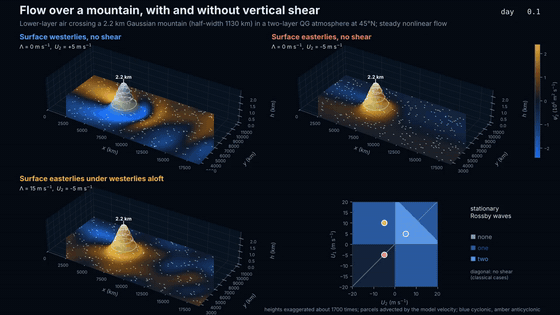
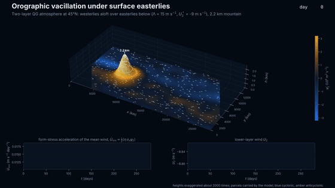
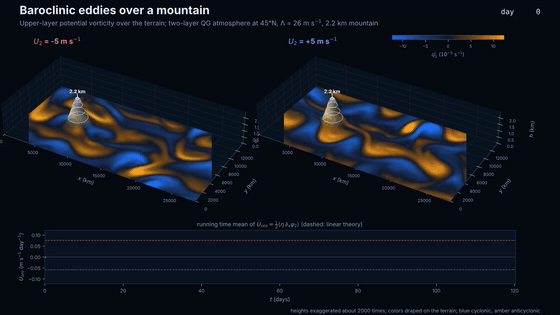

# Supplementary Materials: Orographic Resonance under Surface Easterlies in a Sheared Two-Layer Atmosphere

[](https://doi.org/10.5281/zenodo.24552419)
[](https://www.python.org/)
[](LICENSE)
[](https://numpy.org/)
[](https://scipy.org/)
[](https://matplotlib.org/)


Code, data and animations accompanying the manuscript

> **Orographic Resonance under Surface Easterlies in a Sheared Two-Layer Atmosphere**
>
> Faiz R. Fajary, Sandy H. S. Herho

Westerly flow over a large mountain leaves a train of stationary Rossby waves downstream, with a lee trough followed by ridges and troughs. Easterly flow over the same mountain does not: the disturbance stays near the barrier. This contrast is a textbook result of dynamic meteorology, and it follows from the conservation of potential vorticity on a $\beta$-plane. It is derived for a column moving with one wind. The real atmosphere is sheared: surface easterlies often sit beneath westerlies aloft, in the trade-wind belt under the subtropical jet and in the polar easterlies under the polar-front jet. This repository asks what the classical asymmetry becomes in such a column. It uses a two-layer quasi-geostrophic model with an isolated mountain and a mean wind that feels the mountain's form stress, and it combines closed-form theory, steady states continued in the forcing, long integrations, Lagrangian and information-theoretic diagnostics, and eddy-resolving runs.

The model is idealized. It uses no observational data. The atmosphere is a doubly periodic $\beta$-channel at 45°, the mountain is a Gaussian 2.2 km high, and the shear is held fixed.



## The model in brief

All variables are nondimensional unless units are given. Lengths are scaled by $\mathcal{L} = a\cos 45^\circ = 4505$ km (with $a$ the Earth's radius), velocities by $\mathcal{U} = 10$ m s $^{-1}$, and times by $\mathcal{T} = \mathcal{L}/\mathcal{U} = 5.21$ days. The domain is doubly periodic, $0 \le x < 2\pi$ (28 300 km, one latitude circle at 45° N) and $0 \le y < \pi$ (14 150 km). Here $x$ points east and $y$ north.

### Governing equations

Two layers of equal depth $H$ lie on a $\beta$-plane under a rigid lid; layer 1 is on top and layer 2 touches the ground. Each layer $j = 1, 2$ carries a uniform zonal wind $U_j$ and a perturbation streamfunction $\psi_j(x, y, t)$, with velocities

```math
u_j = U_j - \frac{\partial \psi_j}{\partial y}, \qquad v_j = \frac{\partial \psi_j}{\partial x}.
```

The perturbation quasi-geostrophic potential vorticity (PV) of each layer is

```math
q_1 = \nabla^2\psi_1 + F\,(\psi_2 - \psi_1), \qquad
q_2 = \nabla^2\psi_2 + F\,(\psi_1 - \psi_2) + \eta(x, y),
\qquad F = \frac{k_d^2}{2},
```

where:

- $\nabla^2\psi_j$ is the relative vorticity $\zeta_j$;
- $F(\psi_2 - \psi_1)$ is the stretching of the layer by the interface displacement;
- $k_d = 1/L_d$ is the inverse deformation radius;
- $\eta = f_0 h_b/H$ is the orographic PV of a mountain of height $h_b$, with $f_0$ the Coriolis parameter at 45° N.

The mountain is an isotropic Gaussian,

```math
\eta(x, y) = \eta_0 \exp\!\left[-\frac{(x - x_0)^2 + (y - y_0)^2}{\sigma^2}\right],
```

with peak orographic PV $\eta_0$ and e-folding half-width $\sigma$; periodic images are summed. The mean winds are written through the column-mean wind $U$ and the thermal-wind shear $\Lambda$:

```math
U_1 = U + \frac{\Lambda}{2}, \qquad U_2 = U - \frac{\Lambda}{2}, \qquad
Q_{1y} = \beta + F\Lambda, \qquad Q_{2y} = \beta - F\Lambda ,
```

where $\beta = df/dy$ is the planetary vorticity gradient and $Q_{jy}$ is the meridional gradient of the mean PV in layer $j$. The PV equations are

```math
\frac{\partial q_j}{\partial t} + J(\psi_j, q_j) + U_j \frac{\partial q_j}{\partial x} + Q_{jy}\frac{\partial \psi_j}{\partial x} = \mathcal{D}_j ,
\qquad J(a, b) = \frac{\partial a}{\partial x}\frac{\partial b}{\partial y} - \frac{\partial a}{\partial y}\frac{\partial b}{\partial x},
```

where $J$ is the Jacobian (advection by the perturbation velocity). The damping terms are

```math
\mathcal{D}_1 = \alpha F\,(\psi_1 - \psi_2) - \nu\,\nabla^8 q_1, \qquad
\mathcal{D}_2 = -\alpha F\,(\psi_1 - \psi_2) - r\,\nabla^2\psi_2 - \nu\,\nabla^8 q_2 .
```

They are made of:

- **Ekman drag** $r$ on the lower-layer vorticity;
- **Newtonian cooling** $\alpha$ of the perturbation interface;
- **Hyperviscosity** $\nu$, which removes enstrophy at the smallest scales; its value does not depend on the grid.

The shear $\Lambda$ is held fixed, the limit of strong radiative relaxation of the zonal-mean temperature gradient.

### Interactive mean wind and form stress

The column-mean wind feels the mountain through the orographic form stress (Charney and DeVore 1979):

```math
\frac{dU}{dt} = -\kappa\,(U - U^*) + \frac{1}{2}\,D, \qquad
D = \left\langle \eta\,\frac{\partial \psi_2}{\partial x} \right\rangle ,
```

where:

- $U^*$ is the wind that an external forcing would maintain, and $\kappa$ is its relaxation rate;
- $D$ is the form stress, the domain-mean pressure force of the lower layer on the mountain;
- $\langle\cdot\rangle$ denotes the domain mean.

The surface forcing wind is $U_2^* = U^* - \Lambda/2$. In the figures, $\dot U_{\mathrm{oro}} = D/2$ is the acceleration of the mean wind by the mountain, given in m s $^{-1}$ day $^{-1}$. In a steady state,

```math
U^* = U - \frac{D(U)}{2\kappa},
```

and several values of $U$ for one $U^*$ are multiple equilibria. A fold (turning point) of this curve requires $dD/dU > 2\kappa$.

### Stationary orographic resonance

A free wave $\propto e^{i(kx + ly)}$ with total wavenumber $K = \sqrt{k^2 + l^2}$ is stationary in the two-layer flow when, with $s = K^2 + F$,

```math
P(s) \equiv U_1U_2\,s^2 - \left(Q_{1y}U_2 + Q_{2y}U_1\right)s + Q_{1y}Q_{2y} - U_1U_2F^2 = 0 ,
```

and a root with $s > F$ is a stationary wave that the mountain can force resonantly. On the barotropic diagonal $U_1 = U_2 = U$ the roots are

```math
K^2 = \frac{\beta}{U} \qquad \text{and} \qquad K^2 = \frac{\beta}{U} - 2F ,
```

which exist only for westerlies ($U > 0$). This is the classical westerly-easterly asymmetry.

For subcritical shear ($Q_{1y}, Q_{2y} > 0$):

- **Easterlies in both layers** admit no stationary wave, because every coefficient of $P$ is positive.
- **Opposite winds**, with surface easterlies beneath westerlies aloft, admit exactly one stationary wave whenever $U_1 + U_2 < \beta/F$. The leading coefficient of $P$ is negative and its constant term positive, and
  ```math
  P(F) = \beta\left[\beta - F\,(U_1 + U_2)\right] > 0 .
  ```

The classical asymmetry therefore needs easterlies throughout the column. The two-layer flow is baroclinically unstable (Phillips) for

```math
\Lambda > \Lambda_c = \frac{\beta}{F} = \frac{2\beta}{k_d^2}.
```

### The infinite ridge and the parcel argument

For a meridionally uniform ridge $\eta = \eta(x)$, the steady barotropic streamfunction $\psi = \psi(x)$ makes every Jacobian vanish. The linear Fourier solution is then an exact steady solution of the nonlinear model. Without damping, a streamline displaced to $y(x) = \psi/U$ obeys

```math
U\,\frac{d^2 y}{dx^2} + \beta\,y + \eta(x) = \langle \eta \rangle .
```

The parcel argument can be written as a nonlinear trajectory equation. A parcel moves at constant speed $|U|$ with heading angle $\theta$ and conserves its PV $q_0$, its relative vorticity being the curvature vorticity:

```math
\frac{dx}{dt} = |U|\cos\theta, \qquad \frac{dy}{dt} = |U|\sin\theta, \qquad
\frac{d\theta}{dt} = \zeta = q_0 - \beta\,y - \eta(x) .
```

For small path slopes this reduces to the streamline equation above. For easterlies the balance is evanescent, so as an initial-value problem it amplifies errors as $e^{\sqrt{\beta/|U|}\,x}$.

### Diagnostics

- **Finite-time Lyapunov exponent:** with $\sigma_{\max}$ the largest singular value of the gradient of the parcel flow map over a window $T$,
  ```math
  \lambda_T = \frac{1}{T}\,\ln \sigma_{\max} .
  ```
- **Permutation entropy and statistical complexity:** with $p_i$ the probabilities of the $n = m!$ ordinal patterns of order $m = 5$ in the form-stress series and $p_e$ the uniform distribution,
  ```math
  H = -\frac{1}{\ln n}\sum_{i} p_i \ln p_i, \qquad C = Q_J[p, p_e]\,H ,
  ```
  where $Q_J$ is the normalized Jensen-Shannon divergence from $p_e$.
- **Spectral entropy** of the stationary wave: with $E_k$ the kinetic energy of the time-mean lower-layer streamfunction in wavenumber shell $k$ and $p_k = E_k / \sum E_k$ over $N$ shells,
  ```math
  S = -\frac{1}{\ln N}\sum_k p_k \ln p_k .
  ```

### Parameters

| Symbol | Meaning | Nondimensional | Dimensional |
|---|---|---|---|
| $\beta$ | planetary vorticity gradient at 45° N | 32.9 | $1.62\times10^{-11}$ m $^{-1}$ s $^{-1}$ |
| $f_0$ | Coriolis parameter at 45° N | | $1.03\times10^{-4}$ s $^{-1}$ |
| $H$ | depth of each layer | | 5 km |
| $k_d$, $L_d$ | deformation wavenumber, radius | 5.5 | $L_d$ = 820 km |
| $\Lambda$ | thermal-wind shear $U_1 - U_2$ | 0 to 2.6 | 0 to 26 m s $^{-1}$ |
| $\Lambda_c$ | critical shear for baroclinic instability | 2.17 | 21.7 m s $^{-1}$ |
| $U_2^*$ | surface forcing wind | -1.5 to 1.8 | -15 to 18 m s $^{-1}$ |
| $\eta_0$ | peak orographic PV | 20 | mountain height 2.15 km |
| $\sigma$ | mountain half-width (e-folding) | 0.25 | 1130 km |
| $r$ | Ekman drag on the lower layer | 1.3 | 4 day spin-down |
| $\alpha$ | Newtonian cooling of the interface | 0.26 | 20 days |
| $\kappa$ | relaxation of the mean wind | 0.5 | 10 days |
| $\nu$ | hyperviscosity | $20^{-8}$ | e-folding of 5.2 days at $K = 20$ (1400 km) |

### Numerics

- **Discretization:** the model is pseudo-spectral and doubly periodic, with two-thirds dealiasing, so it is a Galerkin truncation.
- **Time stepping:** ETDRK4 with contour-integral coefficients and a CFL-limited step.
- **Steady states:** Newton's method with dense, exact Jacobians and pseudo-arclength continuation in $U^*$; stability comes from the full eigenvalue spectrum.
- **Parcels:** advanced with the ETDRK4 stages.

All derivations, the proof and the numerical method are in `docs/model.md`.

## Main results

All numbers come from `outputs/reports/results.txt`. Winds are given in m/s. The reference mountain is 2.2 km high in the 5 km lower layer, with an e-folding half-width of 1130 km. The deformation radius is 820 km, and the Phillips critical shear is 21.7 m/s.

**Verification (Fig. 2).** ETDRK4 converges at fourth order (observed orders 4.00, 4.00, 4.01). Two-layer normal modes with drag and cooling grow at the rates of the dispersion relation to within 0.2%. A free Rossby wave keeps its exact phase. Over 50 time units, the two inviscid invariants of the one-layer system with an interactive mean wind drift by $10^{-8}$ (energy) and $6\times10^{-10}$ (potential enstrophy). The time-integrated energy budget closes to $7\times10^{-6}$ of the energy change. Newton's method converges quadratically to $10^{-16}$. As the mountain is lowered, the nonlinear form stress approaches the linear one (ratio 0.999 at 54 m). At the reference height the ratio is 0.27 for westerlies and 0.76 for sheared easterlies, so the 2.2 km mountain is strongly nonlinear. The steady form stress on 48 × 24, 64 × 32 and 96 × 48 grids agrees to 3% and 1% of the finest value; the leading growth rate agrees to 10%.

**The infinite ridge revisited (Fig. 3a-c).** For a meridionally uniform ridge, the linear solution is an exact steady state of the nonlinear barotropic model; its tendency residual is at round-off. Over a 250 m ridge at ±5 m/s it reproduces the two classical cases: a decaying lee-wave train in westerlies (displacements up to 220 km with an 8 day drag; 460 km without drag, close to resonance with a domain mode), and a single confined dip of 110 km in easterlies. the parcel argument, integrated as a nonlinear trajectory equation, follows the exact streamline only for low ridges. Its error grows as the height squared: 0.8% at 100 m, 5% at 250 m, 19% at 500 m and 63% at 1 km for westerlies, and about 2.5 times more for easterlies. Integrated as an initial-value problem, the easterly balance amplifies errors by $e^{\sqrt{\beta/|U|}\,x}$, so it is a boundary-value statement.

**Stationary resonance needs only westerlies aloft (Fig. 4).** The closed-form criterion agrees with the numerical root count at all 127 129 subcritical points of the layer-wind plane. With surface easterlies of 5 m/s, a stationary wave exists at 10, 15 and 20 m/s of shear, with wavelengths of 3100, 4300 and 5100 km. Under a shear $\Lambda$, every surface easterly weaker than $\Lambda$ (with westerlies aloft) admits one. Without shear, none does.

**Linear form stress and multiple equilibria (Fig. 5).** Averaged over surface winds up to 10 m/s, the form stress on easterlies is 8% of that on westerlies without shear and 60% at 21 m/s of shear. More strikingly, the resonance on the easterly side becomes much sharper than on the westerly side: the largest $dD/dU$ is 7.3 against 0.28 at 15 m/s, because the resonant modes are short, weakly damped and largely baroclinic. Folds of the linear equilibrium curve (multiple equilibria in the sense of Charney and DeVore) need a 1.8 km mountain for surface westerlies but 27 km for surface easterlies without shear, with a 52 day relaxation of the mean wind. The easterly threshold drops below the westerly one at 9.5 m/s of shear and reaches 300 m at 16.5 m/s.

**Nonlinear steady states (Fig. 6).** With the 2.2 km mountain and a 10 day relaxation of the mean wind:

* Without shear, the branch is stable everywhere and has no folds.
* At 10 m/s of shear it becomes unstable for surface forcing between -7.1 and -2.7 m/s, with growth rates up to 0.22 per 5.2 days and periods near 40 days.
* At 15 and 20 m/s of shear, the sheared easterly branches carry 21 and 17 folds, all for forcing between -14 and -2 m/s. These are small hysteresis loops (neighbouring folds at most 0.3 to 0.4 m/s apart) along a branch that is unstable over most of its length, with growth rates up to 1.1 per 5.2 days.
* None of the branches has a fold on the westerly side.

Under subcritical shear, instability starts once the upper-layer wind exceeds about 3 m/s, as the resonance criterion with damping implies.

**Orographic vacillation (Fig. 7).** In the long integrations, the flow without shear settles to steady states at every forcing. At 15 m/s of shear, every surface easterly forcing gives an irregular vacillation, with the form stress varying by 1 to 10% (one standard deviation) on dominant periods of 16 to 80 days. The surface easterly regime holds 5 to 47 times more eddy energy (stationary plus transient) than without shear, against 1.4 to 2.4 times on the westerly side. Slow ramps of the forcing show no macroscopic hysteresis: the folds of Fig. 6 are too small and too unstable to hold the flow. The offset between up and down ramps is the lag of the mean wind behind the moving forcing.

**Information and stirring (Fig. 8).** The vacillations lie in the middle of the complexity-entropy plane, with permutation entropy 0.32 to 0.79 and complexity 0.26 to 0.40. That is away from both regular oscillation (low entropy) and noise (entropy near one), in the part of the plane usually occupied by chaotic dynamics. Under shear, the stationary wave over the easterly forcings concentrates in fewer scales: its spectral entropy falls to 0.54 against 0.60 without shear. Lower-layer parcels at a forcing of -9 m/s separate twice as fast with shear: the mean finite-time Lyapunov exponent over 20 days is 0.062 against 0.032 per 5.2 days, and the tail of the distribution is much heavier.

**Baroclinic eddies restore the asymmetry (Fig. 9).** At a supercritical shear of 26 m/s, transient eddies with upper-layer speeds near 33 m/s dominate. With fixed winds of ±5 m/s at the surface, the time-mean form stress over 2.9 years is -0.028 ± 0.019 for westerlies but 0.003 ± 0.013 (two standard errors) for easterlies. The latter is indistinguishable from zero, although linear theory predicts the easterly side to be the larger (0.079 against -0.061). The stationary wave under westerlies keeps a lee trough downstream; under easterlies it collapses to an anticyclone over the mountain. In this regime, strong transient eddies suppress the shear-induced easterly resonance.

## What this may mean

These are results of an idealized model. They are offered as hypotheses for diagnosis in observations and comprehensive models.

* **The classical asymmetry is a statement about the whole column.** Surface easterlies beneath westerlies aloft, as in the trade-wind belt under the subtropical jet or the polar easterlies under the polar-front jet, can have stationary orographic Rossby waves. The relevant wind is the upper-level westerly, not the surface wind.
* **The easterly resonance is sharp and short.** It selects shorter waves than westerly resonance, and its form stress depends sensitively on the wind. In a weakly eddying atmosphere, this favors vacillation and multiple flow regimes under surface easterlies, not under westerlies.
* **Strong baroclinic eddies may erase it.** Where transient eddies are vigorous, the asymmetry returns toward the classical picture. We therefore expect the shear-induced resonance to matter most where shear is moderate and eddies are weak, a hypothesis to test in reanalyses.
* **Parcel arguments are qualitative.** Parcel reasoning is accurate to a few percent only for ridges of a few hundred metres. For major mountain ranges, the flow must be computed rather than inferred from parcels.

## Repository layout

```
orographic_asymmetry_qg/
├── orographic_asymmetry_qg/      # the library
│   ├── params.py                 # scales, physics, orographies
│   ├── spectral.py               # Fourier grid, dealiasing, interpolation
│   ├── model.py                  # one- and two-layer QG model, ETDRK4
│   ├── theory.py                 # resonance, linear response, normal modes, the infinite ridge
│   ├── steady.py                 # Newton, pseudo-arclength continuation, stability
│   ├── diagnostics.py            # energy budget, spectra, entropy, complexity, Fisher information
│   ├── lagrangian.py             # parcels and finite-time Lyapunov exponents
│   ├── experiments.py            # reference configuration, integration driver
│   ├── scene.py                  # animation helpers
│   ├── plotting.py               # figure style
│   └── io.py                     # paths, caches, CSV, NetCDF, reports
├── scripts/
│   ├── compute_*.py              # simulations (results cached as .npz)
│   ├── fig01_model.py ... fig09_eddies.py
│   ├── anim01_mountain.py ... anim03_eddies.py
│   ├── make_reports.py           # every number quoted from the simulations
│   └── run_all.py                # the whole pipeline
├── tests/                        # unit tests, including a PEP 8 check
├── docs/model.md                 # derivations, proof, numerical method
└── outputs/
    ├── figures/                  # PDF and 600 dpi PNG
    ├── animations/               # MP4 and GIF
    ├── data/                     # CSV behind each figure panel
    ├── netcdf/                   # CF-style NetCDF files
    └── reports/                  # plain-text reports
```

## Installation

Python 3.9 or later.

```bash
git clone https://github.com/sandyherho/orographic_asymmetry_qg.git
cd orographic_asymmetry_qg
pip install -e ".[test]"
```

The library depends only on NumPy, SciPy and Matplotlib; NetCDF files are written with SciPy. The animations also need FFmpeg on the system path.

## Reproducing the results

```bash
python scripts/run_all.py            # simulations, figures, reports, animations
python scripts/run_all.py --no-anim  # skip the animations
pytest                               # unit tests and the PEP 8 check
```

The full pipeline takes about five hours on a two-core laptop. Most of the time goes to the continuation of the sheared branches and the long integrations. The compute scripts use all cores unless `QG_WORKERS` is set. Each script can also be run on its own: the continuation keeps one cache per branch and the long integrations one per run, so an interrupted pipeline resumes where it stopped. The figure and report scripts read the caches in `outputs/cache/`. All random seeds are fixed. Setting `QG_PREVIEW=40,200` before an animation script saves only those frames as PNG files.

A minimal example:

```python
import numpy as np
from orographic_asymmetry_qg import theory as th
from orographic_asymmetry_qg.experiments import reference, integrate
from orographic_asymmetry_qg.steady import solve_steady
from orographic_asymmetry_qg.params import BETA

# Stationary waves for 5 m/s easterlies at the surface under 10 m/s
# westerlies aloft, and for easterlies through the column.
F = reference().F
print(th.stationary_wavenumbers(1.0, -0.5, BETA, F))    # one wave
print(th.stationary_wavenumbers(-0.5, -0.5, BETA, F))   # none

# Steady nonlinear flow and its stability, shear 15 m/s, U2* = -5 m/s.
ph = reference(shear=1.5, U=0.25, U_star=0.25)
prob, x, info = solve_steady(ph, (64, 32))
print(info["residual"], prob.spectrum(x, k=3))

# Ten years of the time-dependent flow.
r = integrate(ph, 700.0, grid=(96, 48))
print(r["form_stress"].mean(), r["form_stress"].std())
```

The NetCDF files in `outputs/netcdf/` open directly in xarray, Panoply or ncview:

```python
import xarray as xr
ds = xr.open_dataset("outputs/netcdf/stationary_resonance.nc")
ds["count"].plot(x="U2", y="U1")
```

## Figures

| | |
|---|---|
| `fig01_model` | (a) Section through the two-layer atmosphere with westerlies aloft over surface easterlies; (b) the reference mountain; (c) the layer winds of classical cases and of this study |
| `fig02_verification` | (a) ETDRK4 convergence; (b) growth rates against the dispersion relation; (c) nonlinear over linear form stress; (d) energy budget; (e) Newton convergence; (f) grid convergence |
| `fig03_cases` | (a, b) The infinite ridge, exact QG against the parcel equation; (c) the parcel equation's error against ridge height; (d-f) steady flow and parcel paths over the mountain for westerlies, easterlies, and easterlies under shear |
| `fig04_resonance` | (a) Number of stationary waves over the plane of the layer winds; (b) stationary wavenumbers along the surface wind |
| `fig05_linear_drag` | (a) Linear form stress; (b) easterly over westerly form stress against shear; (c) smallest mountain with multiple equilibria |
| `fig06_branches` | (a-d) Nonlinear steady branches with stability and folds for four shears; (e) growth rates |
| `fig07_dynamics` | (a, b) Slow ramps of the forcing; (c) time-mean wind departure; (d) eddy energy; (e) form-stress series |
| `fig08_mixing` | (a) Complexity-entropy plane; (b) spectral entropy of the stationary wave; (c-e) finite-time Lyapunov exponents |
| `fig09_eddies` | (a, b) Upper-layer PV with baroclinic eddies; (c, d) time-mean stationary waves; (e) time-mean form stress against linear theory |

## Animations

The animations show oblique, lit views of the domain. Distances and heights are in km, with heights exaggerated about 1700 to 2000 times. The 2.2 km mountain carries height contours every 500 m and a summit label. The flow fields are draped over the terrain with color bars in physical units, and the instruments are also in physical units.

**Flow over a mountain, with and without shear.** Steady lower-layer flow for surface westerlies, surface easterlies, and surface easterlies under westerlies aloft. Color is the streamfunction in $10^6$ m² s⁻¹, and parcels travel over the terrain. A fourth panel places the three cases among the stationary-wave regions of the layer winds, in m/s.

**Orographic vacillation under surface easterlies.** The time-dependent flow at the reference shear and the easterly forcing with the largest variability. It shows 500 lower-layer parcels carried by the model and two instruments: the acceleration of the mean wind by the form stress (m s⁻¹ day⁻¹) and the surface wind (m s⁻¹).



**Baroclinic eddies over a mountain.** Supercritical shear, with surface easterlies (left) and westerlies (right). Color is the upper-layer PV anomaly in $10^{-5}$ s⁻¹. The lower panel traces the running mean of the form-stress acceleration (m s⁻¹ day⁻¹) against linear theory.



All fields, parcels and numbers in the animations come from the model. The vertical exaggeration, lighting, hypsometric tint, dark background and glow of the trails are presentation only.

## Limitations

* The atmosphere is a two-layer quasi-geostrophic $\beta$-channel, doubly periodic at 45°. It has no sphericity, no meridional variation of $f$ or $\beta$ beyond the $\beta$-plane, no moisture and no radiation beyond Newtonian cooling, and no stratosphere. A 2.2 km mountain in a 5 km layer stretches the QG assumption of small orography.
* The thermal-wind shear is held fixed, which corresponds to infinitely fast relaxation of the zonal-mean baroclinicity; only the column-mean wind responds to the form stress.
* The doubly periodic domain discretizes the wavenumbers. Part of the sharpness of the linear resonances, and the dense set of small folds on the sheared easterly branches, reflects individual domain modes passing through resonance; a wider domain or a continuous spectrum would smooth them.
* The steady continuation uses a 64 × 32 grid. The form stress agrees with 96 × 48 to about 1%, and growth rates to about 10%. Where the corrector failed, the branches were restarted or completed backward, and short gaps remain.
* The eddy-resolving runs are few and short (2.9 years each) and use fixed mean winds.
* The parcel argument is compared with QG only for a meridionally uniform ridge, where QG is exact.
* No result has been tested against observations or a full general circulation model.

## Citation

If you use this code or its results, please cite the manuscript and this repository:

```bibtex
@article{fajary2026orographic,
  author  = {Fajary, Faiz R. and Herho, Sandy H. S.},
  title   = {{Orographic Resonance under Surface Easterlies in a Sheared Two-Layer Atmosphere}},
  journal = {xxxx},
  year    = {xxxx},
  volume  = {xxxx},
  number  = {xxxx},
  pages   = {xxxx--xxxx},
  note    = {\url{https://doi.org/xxxx}}
}

@misc{fajary2026orographiccode,
  author       = {Fajary, Faiz R. and Herho, Sandy H. S.},
  title        = {{Supplementary Materials: Orographic Resonance under Surface Easterlies in a Sheared Two-Layer Atmosphere}},
  year         = {2026},
  howpublished = {\url{https://github.com/sandyherho/orographic_asymmetry_qg}},
  note         = {Version 0.0.1}
}
```

Machine-readable metadata are in `CITATION.cff`.

## Authors

* Faiz R. Fajary: Atmospheric Science Research Group, Bandung Institute of Technology
* Sandy H. S. Herho: Applied Geology Research Group, Bandung Institute of Technology

## Acknowledgments

This work was supported by the ITB 3P Research Program (Talenta Unggul Scheme), Directorate of Research and Innovation, Bandung Institute of Technology (Project ID DRI.PN-6-64-2026), and by the PPMI Research Program 2026, Faculty of Earth Sciences and Technology, Bandung Institute of Technology (Project ID FITB.PPMI-1-19-2026).

## License

MIT License. Copyright (c) 2026 Faiz R. Fajary and Sandy H. S. Herho.
